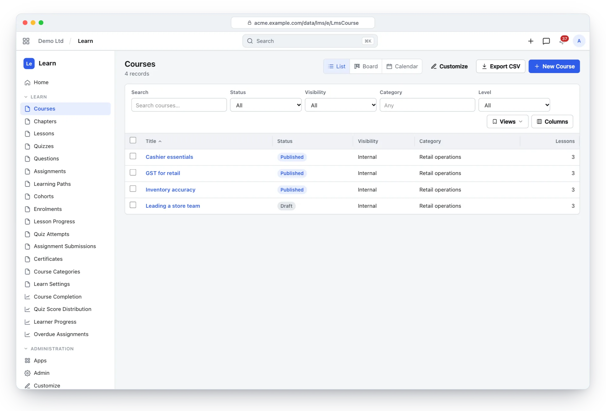
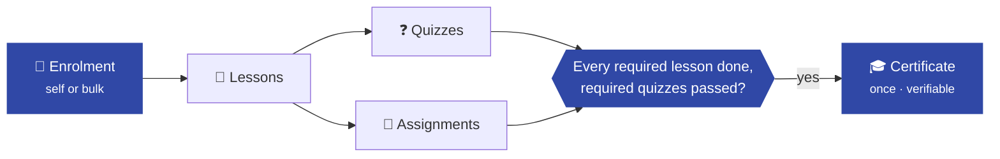
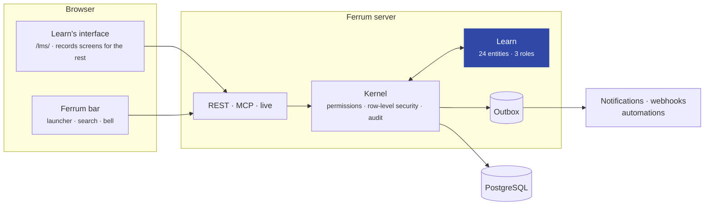
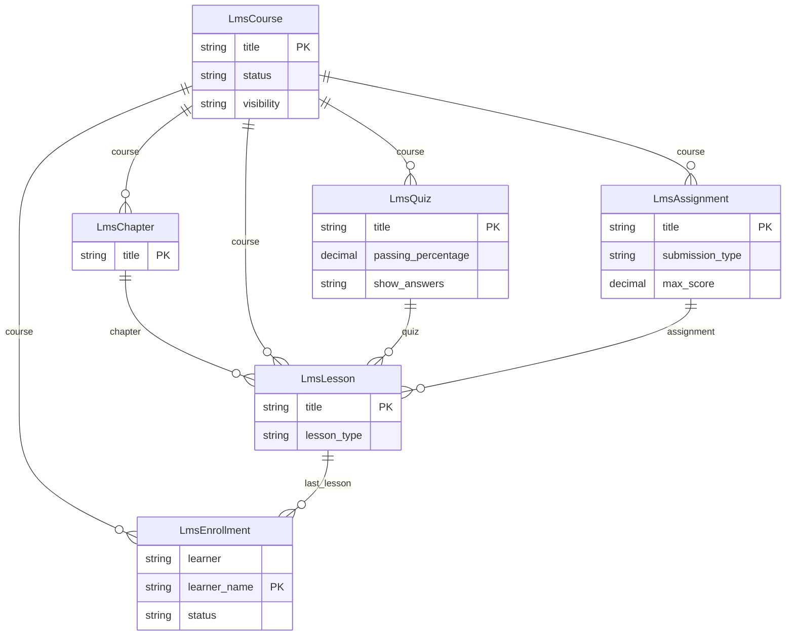

<div align="center">

<picture>
  <source media="(prefers-color-scheme: dark)" srcset="docs/assets/banner-dark.svg">
  
</picture>

[](https://github.com/CBFerrum/ferrum-app-lms/actions/workflows/ci.yml)     

**A native app for [Ferrum](https://github.com/CBFerrum/Ferrum), the open-source, AI-first business platform.**

[Overview](#overview) · [Highlights](#highlights) · [Screenshots](#screenshots) · [How it works](#how-it-works) · [Data model](#data-model) · [Install](#install) · [Develop](#develop) · [Changelog](#changelog)

</div>

---

## Overview

Ferrum Learn is a learning management system: courses with chapters and lessons (articles,
videos, documents, quizzes and assignments), learning paths and cohorts with live sessions, quizzes
whose answer keys learners can never read, assignments graded by instructors, progress computed by
the server, and certificates issued exactly once with a public verification code.


| At a glance | |
|---|---|
| 📦 Version | `0.2.0` |
| 🧱 Platform | Ferrum `>=0.3.2, <0.4` |
| 🔗 Requires | nothing else |
| 🖥️ Interface | Its own at `/lms/` (course player, quizzes, catalog, teaching, course builder); the other records in Ferrum's records screens |
| 🗃️ Records | 24 entities in 1 package |
| 👥 Roles | 3: LMS Manager, Instructor, Learner |
| 📊 Reports | 4 |
| 🧪 Tests | 15 Rust tests, 136 interface tests |


## Highlights

<table>
<tr>
<td width="50%" valign="top">

### 📚 Courses
Chapters and ordered lessons, previews, required lessons and prerequisites.

</td>
<td width="50%" valign="top">

### 🧑‍🤝‍🧑 Cohorts and paths
Capacity, live sessions in the cohort's time zone, one reminder per session.

</td>
</tr>
<tr>
<td width="50%" valign="top">

### ❓ Quizzes
Question banks, time limits on the server, attempt limits that hold under concurrency.

</td>
<td width="50%" valign="top">

### 📝 Assignments
Text or file submissions, grading, feedback and revision requests.

</td>
</tr>
<tr>
<td width="50%" valign="top">

### 🎓 Certificates
Issued exactly once, numbered, printable, verifiable in public.

</td>
<td width="50%" valign="top">

### 🌐 Public catalog
Course pages, learner and instructor dashboards and reports.

</td>
</tr>
</table>

## Screenshots

<picture>
  <source media="(prefers-color-scheme: dark)" srcset="docs/assets/lms-dark.webp">
  
</picture>

<p align="center"><sub>Courses with their level, status and lessons.</sub></p>

> [!TIP]
> The screenshots follow your GitHub theme: switch between light and dark to see both.

## How it works

### From enrolment to certificate



### Inside Ferrum



Everything Learn adds is ordinary Ferrum metadata and Rust: its records get lists, forms,
search, permissions, an audit trail, exports and the REST and MCP APIs for free, so AI agents work
with them under the same rules as people.

## Data model

The main records and how they connect (24 entities in all; `packages/` has every field).



### Roles

| Role | What it is for | Entities |
|---|---|---|
| **LMS Manager** | Runs the learning programme — every course, question bank, cohort, enrolment, grade and certificate, and Learn Settings. | 15 |
| **Instructor** | Builds the courses they teach (chapters, lessons, question banks, quizzes, assignments, cohorts), enrols learners in them, grades submissions and follows progress. Give the user LmsCourse scopes to limit what they see to some courses. | 17 |
| **Learner** | Takes courses — enrols in published courses, works through lessons, attempts quizzes, submits assignments and earns certificates — and sees only their own enrolments, progress, attempts, submissions and certificates. | 8 |

<details>
<summary><b>Reports (4)</b></summary>

- Lms Course Completion
- Lms Quiz Scores
- Lms Learner Progress
- Lms Overdue Assignments

</details>

## Install

Workspace administrators install it from **Apps** (`/store/`) in Ferrum; it ships in the
official Ferrum server image. Self-hosters building their own image enable the
`lms` feature of the server. Everything it adds is also available to AI agents over
Ferrum's MCP server, within each person's permissions.

## Develop

Clone it next to the platform:

```text
work/
├── ferrum/            https://github.com/CBFerrum/Ferrum
└── ferrum-app-lms/
```

Point the platform dependencies at your checkout (this file is git-ignored):

```toml
# .cargo/config.toml
[patch."https://github.com/CBFerrum/Ferrum"]
ferrum-calc = { path = "../ferrum/crates/calc" }
ferrum-domain = { path = "../ferrum/crates/domain" }
ferrum-kernel = { path = "../ferrum/crates/kernel" }
ferrum-meta = { path = "../ferrum/crates/meta" }
ferrum-apps = { path = "../ferrum/crates/apps" }
```

The tests need PostgreSQL with an ordinary (non-superuser) role, so row-level security
applies:

```bash
createuser ferrum --pwprompt && createdb -O ferrum ferrum_lms_test
cargo test
```

`FERRUM_LMS_TEST_DATABASE_URL` overrides the database URL.

### The interface

`ui/` holds Learn's own interface (React, built with the platform's web packages from the checkout
next to this one, `../ferrum/web`). Its built files in `ui/dist` are committed and embedded in the
crate, so a change to `ui/src` is not done until `dist` is rebuilt:

```bash
cd ui
npm run test       # logic, and every screen drawn to markup from data in the query cache
npm run typecheck
npm run build      # writes dist/
npm run check      # fails if dist/ is not built from these sources, or is over the size budget
```


### Project layout

```text
app.yaml      the manifest: id, version, requirements, what it adds to Ferrum
packages/     metadata: entities, roles, reports, workflows, print formats
src/          the app's logic in Rust: hooks, actions, endpoints, upkeep jobs
tests/        integration tests against a real PostgreSQL
ui/           the interface: src/ (React and the logic it is tested by) and dist/ (built from it)
CHANGELOG.md  what changed in each version
```

## Changelog

| Version | Highlights |
|---|---|
| **0.2.0** | Learn's own interface at `/lms/`: the learner's course player, quiz player, assignments and certificates, the catalog and course pages (also public, with a certificate check), and for instructors the teaching dashboard, grading queue and course builder … |
| **0.1.0** | First release of Learn: courses with chapters and ordered lessons (articles, allowlisted videos, documents, quizzes, assignments; free previews … |

Every version is in [CHANGELOG.md](CHANGELOG.md).

## License

[AGPL-3.0-only](LICENSE), like the platform. Part of [Ferrum](https://github.com/CBFerrum/Ferrum) ·
[Report an issue](https://github.com/CBFerrum/ferrum-app-lms/issues)
